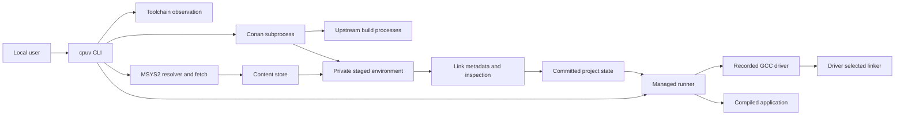

# 03 · Architecture deep dive

[Index](MASTER_INDEX.md) · [Walkthrough](06_CODE_WALKTHROUGH.md) · [Diagrams](diagrams/README.md)

## Contents

- [Architecture and boundaries](#architecture-and-boundaries)
- [Provider paths](#provider-paths)
- [Execution and state](#execution-and-state)
- [Failure and recovery](#failure-and-recovery)
- [Trade-offs and coupling](#trade-offs-and-coupling)

## Architecture and boundaries

cpuv is a modular monolithic CLI. The CLI orchestrates six supporting Rust libraries; it does not communicate with them through HTTP or RPC. A Tokio runtime drives HTTP futures and synchronization workflows. Blocking extraction jobs enter the blocking thread pool. Many compiler and provider subprocesses still use synchronous `Command` APIs; async entry points do not make all work nonblocking.

The system boundary contains first-party discovery, resolution for MSYS2, downloading, content storage, relocation, linking, inspection, runner, installer, and updater. Conan's graph resolver, package recipes, download/extraction implementation, and build-system helpers live outside that boundary. GCC performs compilation and linker invocation. Windows supplies process execution, DLL loading, registry operations, file locks, and hardlinks.

Scope: current dependency installation and execution only. `main::sync`, `source::sync`, `runner::run`, and `compiler_args` establish these relationships. There are no implied network services between the boxes.

## Provider paths

The MSYS2 path probes the compiler, validates project inputs, obtains or replays a version-1 lock, resolves the snapshot, checks runtime packages, validates cached content, downloads missing archives, and ingests at most four archives concurrently. `Store::materialize` creates a staged environment with hardlinks or copies. Relocation privately replaces metadata files before changing their prefixes. Linking derives a public interface from package-owned modules, then binary inspection prepares evidence. A set of file swaps commits the environment, manifest, and lock.

The Conan path preserves or migrates saved flags, re-probes using those flags, runs `doctor`, and prepares SHA-256-pinned standalone tools. A profile key combines toolchain observations, compiler executable digest, flags, project standard, and adapter revision. Each key has a separate Conan home and exclusive operation lock. The adapter verifies provider cache manifests, invokes Conan install with explicit profiles, full deployment, and PkgConfigDeps, checks manifests again, translates graph ownership into link metadata, collects runtime DLLs, and inventories the stage. Version-3 locks embed upstream revision references. Normal commit covers five project artifacts.

Source packages are not resolved by header scanning. ConanCenter is not just another archive layout inside the MSYS2 solver: it is a separate external resolver/build adapter. Provider switching is persistent after success and can fail if existing root names differ between catalogs.

## Execution and state

`cpuv.exe` can act as three entry modes. Its normal name parses CLI commands. The name `cpuv-setup.exe` selects native setup before ordinary parsing. Names recognized as C++ compiler drivers select the shim. Initialization copies the CLI into `.cpuv/bin/g++.exe`, enabling one application executable to provide the shim without another download.

The managed runner reads `Environment`, rewrites a supported subset of compiler outputs into `.cpuv/build`, supplies metadata arguments directly to the recorded compiler, and launches successful program links. The activated raw shim supplies the same metadata but uses ordinary GCC output placement and deploys imported DLLs next to the output. They share `compiler_args`; their output-placement and DLL-deployment paths are different.

Persistent ownership is filesystem-based: project text configuration is portable, `.cpuv` is local, and the shared cache is reusable. There is no first-party database migration service. Package locks, project locks, build locks, and catalog profile locks have different scopes and are not one global transaction. No background worker survives a normal CLI invocation.

## Failure and recovery

Preparation happens before environment swaps. Failed download, extraction, metadata, or inspection ordinarily discards the stage and keeps active project state. MSYS2 commits three main artifacts and writes local toolchain/activation/report files afterward; failures after that point can report an error after the core update succeeded. Its rollback can itself fail and lacks the catalog path's explicit backup-retention branch. Conan rollback retains recovery files when restoration fails. Neither path is a power-loss-safe database transaction.

The compiler build lock remains held through execution of a managed program. Dependency operations use a separate project lock. Consequently running programs and package updates are not protected by one shared reader/writer lock; Windows file sharing and rename failures can affect updates. Network futures have bounded retries and timeouts; upstream provider/build subprocesses do not share those deadlines. See [operations](15_ERROR_HANDLING_AND_OPERATIONS.md).

## Trade-offs and coupling

**Observed:** Rust library boundaries isolate parsing, storage, and compiler integration. **Inference:** keeping the hot path in-process reduces deployment components, while subprocess integration avoids reimplementing compiler and community build systems. Costs include synchronous process waits, implicit environment effects, and upstream metadata/version coupling.

The CLI's large `main.rs` combines command declarations, schemas, provider dispatch, MSYS2 staging, and diagnostics. The catalog module imports parent symbols through `use super::*`, making schema changes tightly coupled. Binary and catalog commit algorithms are duplicated and have different recovery guarantees. Optimization should follow measurements, especially cache hashing and whole-tree inspection, rather than the earlier aspirational latency targets.

Sources: [CLI](../../crates/cpuv-cli/src/main.rs), [catalog](../../crates/cpuv-cli/src/source.rs), [shim](../../crates/cpuv-shim/src/lib.rs), [fetch](../../crates/cpuv-fetch/src/lib.rs), [relocation](../../crates/cpuv-relocate/src/lib.rs). Decision alternatives and change conditions are recorded in [chapter 13](13_ENGINEERING_DECISIONS_AND_TRADEOFFS.md).
