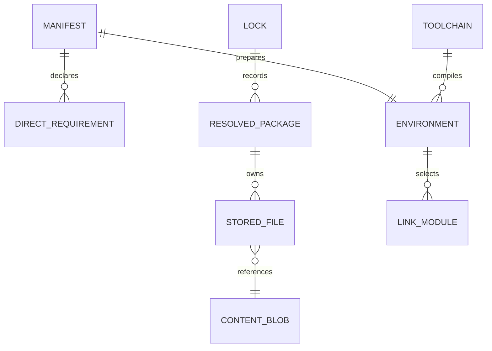

# 07 · Data model and storage

[Index](MASTER_INDEX.md) · [Configuration](12_CONFIGURATION_AND_ENVIRONMENT.md) · [Recovery](15_ERROR_HANDLING_AND_OPERATIONS.md)

## Ownership and formats

There is no first-party SQL/NoSQL engine, database server, migration directory, or relational schema. TOML expresses portable user/project state; JSON expresses local runtime interfaces, inventories, diagnostics, and content-store records. Binary archives and content blobs supply payload. Conan's internal storage is external provider state: cpuv does not implement or migrate its internal database.

| Location relative to project/cache | Producer and consumer | Contents and retention |
| --- | --- | --- |
| `cpuv.toml` | CLI reads/writes | Portable project, compiler pins, direct roots, backend, explicit link selections |
| `cpuv.lock` version 1 | MSYS2 `sync` | Repository, ABI hash, root declarations, full package records |
| `cpuv.lock` version 3 | Catalog `sync` | Backend, root declarations, saved flags, GCC/ABI observations, package versions, embedded provider revision lock |
| `.cpuv/toolchain.json` | Probe/CLI; diagnostics | Detected executable paths, linker, provider, observations |
| `.cpuv/env/manifest.json` | Relocation/catalog; runner/shim | Serialized `Environment`, schema 1 and link model 2 |
| `.cpuv/env/link-plan.json` | `linking::apply` | Selected modules, traversed public graph, libraries/flags, authority description |
| `.cpuv/env/compatibility.json` | Binary inspector | Architecture/import/export evidence and explicit unproven conditions |
| `.cpuv/env/install-state.json` | MSYS2 `sync` | Serialized identity used for environment reuse decisions |
| `.cpuv/env/catalog-profile.json` | Catalog adapter | Local compiler/profile key and provider graph, including local paths |
| `.cpuv/env/catalog-files.json` | Catalog adapter | Relative deployed filenames to SHA-256 digests |
| `.cpuv/build` | Managed runner | Executables, objects, supported auxiliary outputs, temp directory, build lock |
| `.cpuv/build/legacy/cleanup-*` | `clean` | Preserved loose artifacts and original filename list; no automatic deletion |
| cache `index/<repository SHA-256>.db` | Fetcher | Compressed repository snapshot; fresh for one hour unless refresh/offline rules override |
| cache `archives/<archive SHA-256>.pkg.tar.zst` | Fetcher | Verified MSYS2 archives retained for reuse |
| cache `store/packages/<archive SHA-256>` | Store | `cpuv-pkg.json` and payload; archive identity is package key |
| cache `store/blobs/<first two hex>/<BLAKE3>` | Store | Per-file content identity; hardlinks share bytes |
| cache `catalog/archives`, `tools/<key>` | Tool bootstrap | Pinned archives and extracted tools with `files.json` inventories |
| cache `catalog/homes/<profile key>` | Conan adapter/provider | Profile-scoped upstream cache and `cpuv-profile` |
| cache `catalog/logs/*.log` | Adapter | Command/debug output and complete provider/build diagnostics; no rotation policy |

## Important types

`Package` has string `name`, `version`, `filename`, `sha256`; unsigned size; and string lists `depends`, `provides`, `conflicts`. `Index` is a `BTreeMap<String, Package>`. `StoredFile` has a safe relative `PathBuf`, BLAKE3 string, and size. `StoredPackage` embeds the complete `Package` and a list of those files. These are content records rather than database rows with foreign-key enforcement.

`Environment` contains schema/link-model versions, compiler/compiler-bin paths, ABI hash, language standard, include/library directories, libraries, definitions, compile/link flags, diagnostic include map, binary-presence marker, dependency-origin string, source architecture, and source flags. Directory strings are generally relative to the environment. The compiler paths are intentionally machine-local. The catalog adapter uses the internal origin label `source` even though the user-facing backend is `conan`.

`AbiTuple` records schema, OS, architecture, target, compiler family/major, standard library/release/dual ABI, C runtime, thread/exception models, language ceiling, and build type. The ABI hash is a truncated BLAKE3 digest of this tuple; additional observed ABI macros are not all part of that tuple. The broader catalog key includes the complete toolchain object and compiler-file digest.

## Entity relationships

Scope: conceptual relations between filesystem records, not implemented SQL constraints. `Manifest`, `Lock`, `StoredPackage`, `StoredFile`, and `Environment` establish these relations. Some relationships are validated procedurally during resolution/commit.

## Integrity, concurrency, and evolution

SHA-256 verifies downloaded archives; BLAKE3 addresses MSYS2 file blobs and validates cached payload. Tool/deployment inventories use SHA-256. Conan cache manifests are checked through Conan commands; their implementation is outside this source tree. No digest is a publisher signature.

Project and build locks fail promptly on contention; package-ingestion locks block; catalog home and update locks fail promptly. Windows locks are file-handle scoped. Cached payload can be hardlinked into projects, so editing one link may change the cache and other projects. Relocation breaks metadata hardlinks before editing. Shared cache content has no garbage-collection or reference-counted deletion operation; `rm` changes reachability in the project and retains the cache.

Version-2 source locks migrate to catalog resolution while retaining supported saved profile fields. They do not replay their former library recipes. Version-3 input requires its full schema; unsupported lock versions fail. Environment schema/link-model checks protect compiler consumers, but manifests generally do not deny all unknown top-level fields. There is no formal standalone schema document or universal forward-migration engine.

Staged swaps provide normal-error recovery, not journaled crash durability. Sensitive state includes PATH backups, compiler paths, and arbitrary user flags in logs/locks. No application-managed encryption, credential store, or additional ACL setup was found. Sources: [schemas and commit](../../crates/cpuv-cli/src/main.rs), [catalog](../../crates/cpuv-cli/src/source.rs), [store](../../crates/cpuv-store/src/lib.rs), [runtime schema](../../crates/cpuv-relocate/src/lib.rs).
