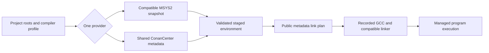

# cpuv project encyclopedia

An engineering knowledge base for the inspected cpuv implementation: purpose, source structure, execution, schemas, trust, operations, history, and limitations.

**2026-10-18 update:** [Application uninstall](APPLICATION_UNINSTALL_UPDATE.md) adds `cpuv uninstall` and `--dry-run`, with native executable/helper removal and conservative user PATH cleanup. The chapters, hashes, counts, and audit results below retain their dated 2026-10-17 baseline; earlier “not found” uninstall statements describe that baseline rather than the updated application. The update documents the new source and verification separately.

**Release documentation:** [v0.0.2 release notes](../release-notes/v0.0.2.md) describe the catalog adapter, dependency removal, application uninstall, and current distribution. Statements about an uncommitted tree or unpublished release in the baseline chapters refer to the original audit date; they are not live GitHub release status.

**Last verified:** 2026-10-17, Asia/Calcutta. **Application:** 0.0.2 working tree. **Git base:** `4889f1f` on `main`; this is a dirty tree containing earlier catalog work and the newly requested `rm` alias. No commit or release publication is implied by this documentation snapshot.

## Reading routes

- New users/engineers: overview → domain model → architecture → walkthrough → build/run → glossary.
- Contributors: file guide → walkthrough → configuration/storage → quality → contributor manual → known issues.
- Architects/auditors: architecture → storage/interfaces → security → decisions → performance/operations → status/history → coverage/reference.

## Complete documentation map

| Chapter | Purpose |
| --- | --- |
| [01 · Project overview](01_PROJECT_OVERVIEW.md) | What cpuv solves, users, components, requirements and boundaries |
| [02 · Requirements and domain model](02_REQUIREMENTS_AND_DOMAIN_MODEL.md) | Reconstructed requirements, ownership, entities and invariants |
| [03 · Architecture deep dive](03_ARCHITECTURE_DEEP_DIVE.md) | In-process components, provider/process boundaries, state and recovery |
| [04 · Languages and stack](04_PROGRAMMING_LANGUAGES_AND_TECH_STACK.md) | Source distribution, exact technology roles/versions and interoperability |
| [05 · Repository/file guide](05_REPOSITORY_AND_FILE_BY_FILE_GUIDE.md) | Important files, symbols, callers, responsibilities and modification risks |
| [06 · Code walkthrough](06_CODE_WALKTHROUGH.md) | Actual startup, init, resolution, removal, compile/run and update paths |
| [07 · Data model/storage](07_DATA_MODEL_AND_STORAGE.md) | Project/runtime/cache records, identity, lifecycle and locks |
| [08 · Interfaces/protocols](08_API_AND_COMMUNICATION_PROTOCOLS.md) | CLI, process, file and HTTP contracts; no invented server API |
| [09 · Security/trust](09_SECURITY_AND_TRUST_MODEL.md) | Publisher/process boundaries, controls, findings and unverified assurances |
| [10 · Build/run/deploy](10_BUILD_RUN_TEST_AND_DEPLOY.md) | Reproducible commands and distinction between checked and inferred procedures |
| [11 · Testing/quality](11_TESTING_AND_QUALITY.md) | Real checks/results, absent retained suites, gaps and priorities |
| [12 · Configuration/environment](12_CONFIGURATION_AND_ENVIRONMENT.md) | Flags, defaults, ranges, manifest fields, environment and tooling parameters |
| [13 · Decisions/trade-offs](13_ENGINEERING_DECISIONS_AND_TRADEOFFS.md) | Evidence-based records with documented/inferred rationale and alternatives |
| [14 · Performance/scalability](14_PERFORMANCE_AND_SCALABILITY.md) | Derivable complexity, memory/concurrency costs and measurement needs |
| [15 · Errors/operations](15_ERROR_HANDLING_AND_OPERATIONS.md) | Retries, deadlines, partial failures, diagnostic playbook and recovery |
| [16 · Status/roadmap](16_IMPLEMENTATION_STATUS_AND_ROADMAP.md) | Verified, insufficiently tested, partial, absent and recommended work |
| [17 · Glossary](17_GLOSSARY_AND_CONCEPTUAL_FOUNDATIONS.md) | ABI/compiler, package/metadata, storage/execution and trust concepts |
| [18 · Contributor/extension manual](18_CONTRIBUTOR_GUIDE_AND_EXTENSION_MANUAL.md) | Safe command/provider/schema/compiler extensions and review practices |
| [19 · Issues/technical debt](19_KNOWN_ISSUES_AND_TECHNICAL_DEBT.md) | Confirmed limitations versus potential risks, mitigation and proposed regressions |
| [20 · Timeline/history](20_PROJECT_TIMELINE_AND_HISTORY.md) | Three recoverable commits, local tag, working-tree changes and historical limits |
| [21 · Reference catalog](21_REFERENCE_CATALOG.md) | Every baseline source symbol, direct crate dependency and locked package version |
| [Coverage matrix](COVERAGE_MATRIX.md) | All 52 baseline files, audit scope, check boundary and remaining gaps |
| [Diagram collection](diagrams/README.md) | Context/trust, crate graph, removal sequence, data flow, state and deployment |
| [Machine-readable source inventory](source-inventory.json) | Snapshot-relative hashes, physical line counts and lexical symbol locations |

## System model

Scope: current high-level workflow, implemented by [main sync](../../crates/cpuv-cli/src/main.rs), [catalog adapter](../../crates/cpuv-cli/src/source.rs), [linking](../../crates/cpuv-relocate/src/linking.rs), and [runner](../../crates/cpuv-cli/src/runner.rs). The diagram does not imply package-by-package federation or universal ABI conversion.

## Status summary

**IMPLEMENTED:** seven Rust components, MSYS2 resolution/download/CAS, generic ConanCenter fallback, saved profiles, native compiler integration, managed output/run behavior, native setup/self update, and direct dependency removal. `cpuv rm` is now a visible alias for the existing removal path. Shared caches remain after dependency removal; unreachable packages disappear from the project environment.

**Verified for this request:** formatting, Clippy, locked release build, installed alias/help, six removal scenarios across both providers including invalid/last-root/offline cases, compilation after catalog removal, and local release packaging. Full results and limits are in [quality](11_TESTING_AND_QUALITY.md).

**PARTIALLY IMPLEMENTED or bounded:** compatibility inspection, filesystem transactions/recovery, offline isolation, private/static link semantics, generated-metadata reuse validation, and provider configuration parity. The nested catalog static-archive inspection gap is confirmed by source and a retained environment report. MSYS2 rollback retention is weaker than catalog rollback under restoration errors.

**NOT FOUND or outside scope:** first-party web/database service, accounts, daemon, retained automated tests, sandboxing, package signatures, native self-uninstall, cache GC, universal library/compiler/linker support. No live remote publication, CVE assurance, complete upstream audit, or minimum-platform matrix is claimed.

## Evidence vocabulary and document gaps

- **IMPLEMENTED:** an actual reachable source path exists; dynamic verification is stated separately.
- **PARTIALLY IMPLEMENTED:** a concrete subset exists, with missing behavior identified.
- **PLANNED:** explicit repository future-work evidence; audit recommendations are labeled separately.
- **UNVERIFIED:** evidence is insufficient for the stronger claim or runtime/platform matrix.
- **NOT FOUND:** absent within the inspected first-party scope, not proof of absence everywhere historically.
- **CONFLICTING:** sources or declared versus actual behavior disagree, with the disagreement preserved.

Facts, inferred rationale, and recommendations are separated throughout. Significant claims identify files and symbols. The baseline includes 19 Rust sources/6,003 physical lines plus scripts/manifests/workflows/docs; it excludes ignored generated output and third-party source internals. Full tests, fault-injected rollback, upstream recipe coverage, live release state, and controlled performance results remain gaps. [Coverage](COVERAGE_MATRIX.md) records the exact boundary and final consistency result.

During encyclopedia generation, application/configuration/pre-existing documentation content was preserved against the post-feature baseline. The authorized new application change was the `rm` alias; preceding catalog changes were already present. This task did not commit/push or alter Git history. Local executable/release assets were refreshed to deliver the feature.
