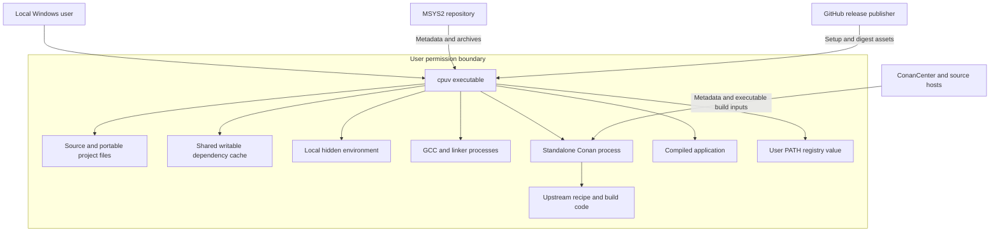
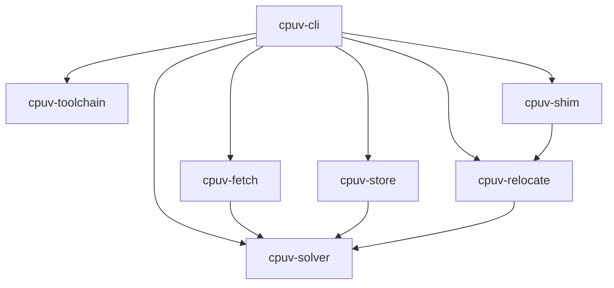
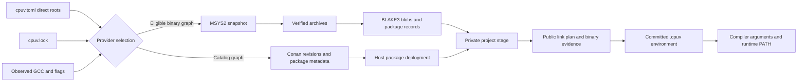
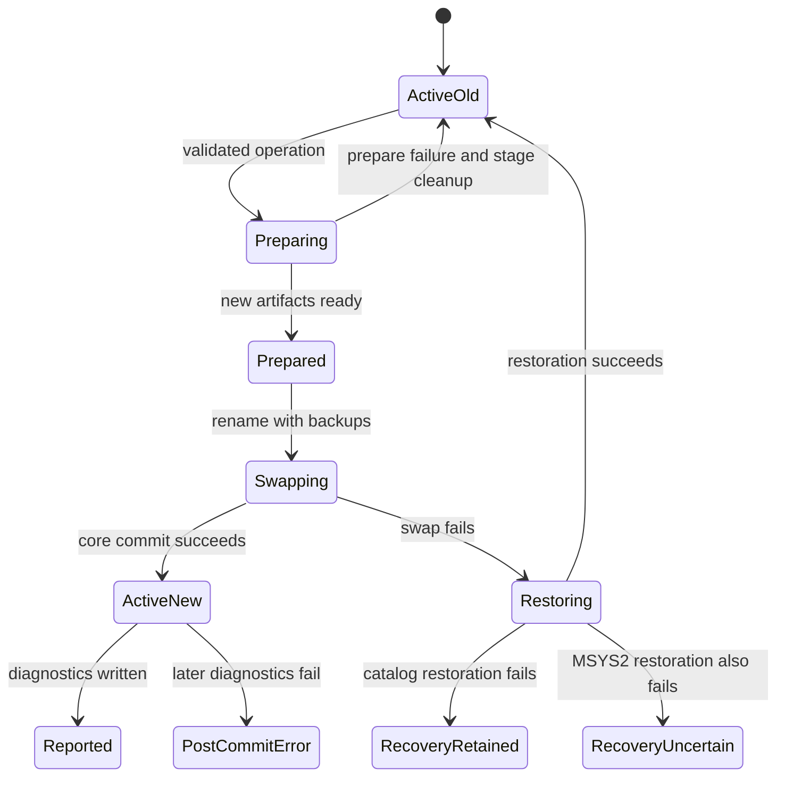
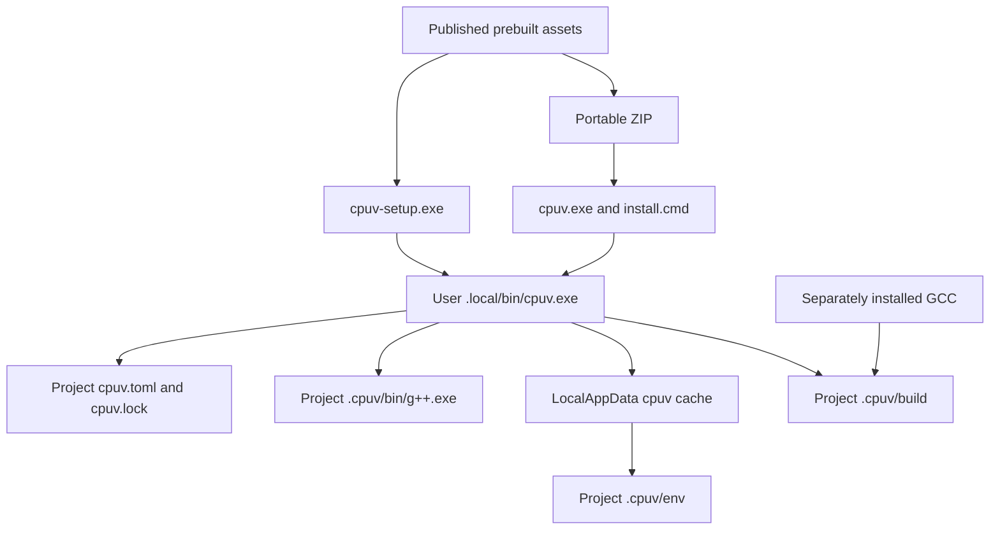

# Architecture diagrams

[Master index](../MASTER_INDEX.md) · [Architecture](../03_ARCHITECTURE_DEEP_DIVE.md) · [Walkthrough](../06_CODE_WALKTHROUGH.md)

All diagrams describe inspected implementation unless an uncertainty is explicitly labeled. They are Mermaid source, not claims of separately deployed services. Conceptual relationships do not imply SQL tables or network APIs. The entity diagram is in [storage](../07_DATA_MODEL_AND_STORAGE.md).

## System context and trust boundaries



Scope: trust and process/data relationships. Each subprocess shares user permissions; the boxes are not sandboxes. Publisher-controlled checksums do not independently authenticate publishers. Sources: [CLI](../../../crates/cpuv-cli/src/main.rs), [catalog](../../../crates/cpuv-cli/src/source.rs), [installer](../../../crates/cpuv-cli/src/install.rs), [updater](../../../crates/cpuv-cli/src/update.rs).

## In-process crate dependencies



Scope: first-party Rust direct dependencies, not all transitive crates. The separate shim executable and CLI share the shim library. Sources: [workspace](../../../Cargo.toml) and all seven per-crate Cargo manifests, enumerated in [reference](../21_REFERENCE_CATALOG.md#direct-component-dependencies).

## Dependency removal lifecycle

```mermaid
sequenceDiagram
    actor User
    participant CLI as Clap and execute
    participant Sync as sync coordinator
    participant Provider as MSYS2 or Conan
    participant Stage as Staged environment
    participant Live as Active project files
    User->>CLI: cpuv rm package
    CLI->>Sync: update roots with remove=true
    Sync->>Live: Read manifest and acquire project lock
    Sync->>Sync: Remove exact direct key in local copy
    alt Not a direct dependency
        Sync-->>User: Error before saving edited manifest
    else Valid roots
        Sync->>Provider: Resolve remaining roots
        Provider->>Stage: Prepare reachable packages and interfaces
        Stage->>Stage: Validate metadata and inspection evidence
        alt Preparation fails
            Sync-->>User: Error; old environment remains active
        else Prepared
            Sync->>Live: Commit environment, manifest and lock
            Sync-->>User: Updated graph; shared caches retained
        end
    end
```

Scope: ordinary prepare/success behavior. Filesystem commit and rollback failures are separately represented below. Source: [`Action::Remove`, `execute`, `sync`](../../../crates/cpuv-cli/src/main.rs), [`source::sync`](../../../crates/cpuv-cli/src/source.rs). No per-package uninstall script is implied.

## Data flow and provider isolation



Scope: provider-level isolation. There is no arrow from an individual MSYS2 package into a Conan dependency graph; fallback re-resolves the whole manifest. Sources: [main sync](../../../crates/cpuv-cli/src/main.rs), [catalog](../../../crates/cpuv-cli/src/source.rs), [store](../../../crates/cpuv-store/src/lib.rs), [linking](../../../crates/cpuv-relocate/src/linking.rs).

## Commit state machine and recovery



Scope: normal-error filesystem behavior, not power-failure recovery. `RecoveryUncertain` is an audited limitation, not a supported recovery state with an automated command. Catalog `commit` explicitly retains backup files after restoration errors; MSYS2's separate implementation does not provide the same branch. Sources: [main sync commit](../../../crates/cpuv-cli/src/main.rs), [catalog commit](../../../crates/cpuv-cli/src/source.rs).

## User-machine deployment



Scope: public native/portable installation, not developer copy-install defaults. Developer `scripts/install.ps1` can also update LocalAppData/bin and a compatibility copy. The executable does not bundle GCC or a universal ABI. Sources: [installer](../../../crates/cpuv-cli/src/install.rs), [packaging](../../../scripts/package.ps1), [build runner](../../../crates/cpuv-cli/src/runner.rs).
