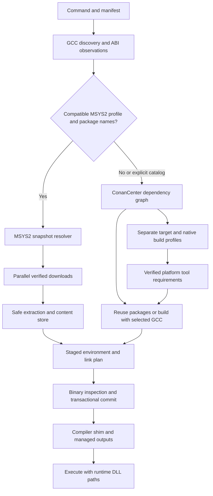

# Architecture overview

cpuv 0.0.4 manages native Windows C/C++ dependencies and compilation. GCC/MSYS2/Conan is the main acceptance lane; MSVC, GNU-style Clang, named configurations, CMake/CTest and pinned vcpkg integration have explicit [compatibility boundaries](docs/compatibility.md). It discovers the real compiler, selects one package provider, prepares a hidden environment, and compiles and executes programs using package metadata.

The core MSYS2/Conan path is shown below; vcpkg owns a separate native CMake graph. Common content inventories, compiler/SDK identity, process-lifetime leases and journal recovery protect environment use and updates. See the [current architecture](docs/architecture.md) and [0.0.4 notes](docs/release-notes/v0.0.4.md).

## Components

| Crate | Responsibility |
| --- | --- |
| cpuv-cli | Commands, catalog adapter, locks, tool bootstrap, managed run, native setup, self update, uninstall, and toolchain management |
| cpuv-toolchain | GCC discovery, macro probes, language capabilities, ABI observations, provider eligibility |
| cpuv-solver | MSYS2 constraints, virtual providers, package-name suggestions |
| cpuv-fetch | MSYS2 metadata and parallel downloads, retries, size/time limits, offline behavior |
| cpuv-store | Validated extraction, BLAKE3 storage, records, hardlinks and copy fallback |
| cpuv-relocate | Relocation, public pkg-config link plans, ABI guards, PE/COFF inspection, experimental specs |
| cpuv-shim | Recorded GCC invocation with the prepared interface |

All first-party runtime code is included. The CLI creates its shim from its own executable. Cargo.lock pins third-party Rust dependencies. build-tools.toml pins bootstrap tools only; cpuv contains no library recipe registry or library-specific patches.

## Toolchain and providers

Discovery checks an explicit executable, CPUV_CXX, CXX, a verified cpuv selection, PATH, then discovered MSYS2 roots and Windows records. Generated shims are excluded. No personal path or compiler installation directory is embedded in code. Detected paths belong in local metadata.

The probe records version, target, architecture, C runtime, threads, exceptions, libstdc++ version/dual ABI, language capabilities, and ABI macros. cpuv doctor compiles, links, and runs a real probe. GCC invokes its own linker; incompatible object formats and arbitrary linkers cannot be translated.

MSYS2 binaries require a recognized UCRT64/UCRT or MINGW64/MSVCRT x86-64 POSIX/SEH profile, dual ABI 1, and matching runtime packages. This path uses one rolling snapshot, SHA-256 checks, bounded extraction, shared content storage, and staged hardlink materialization. Pacman hook metadata is discarded. Explicit base-devel installation delegates to host pacman outside the project transaction.

Missing packages, other supported native MinGW profiles, custom flags, and --catalog select ConanCenter for the whole graph. Standalone Conan/CMake/Ninja bootstrap without system Python or Rust. Upstream metadata supplies versions, dependencies, build systems, sources, tools, and interfaces. Compatible packages are reused; missing binaries build with the selected GCC. --from-source forces source builds including build requirements.

Packages must exist in the catalog and support the selected compiler/platform/features/tools. Cygwin catalog builds, MSVC/Clang, vcpkg, arbitrary archives, and cross-OS adapters are outside this release.

## Locks, profiles, and storage

MSYS2 version-1 locks record versions, checksums, ownership, and an ABI filter. Catalog version-3 locks embed upstream revisions, resolved versions, compiler observations, and saved flags. Legacy source locks migrate on successful synchronization. Portable locks contain no detected local compiler/cache paths.

CPPFLAGS/CFLAGS/CXXFLAGS/LDFLAGS define the saved catalog profile. Dependencies and consumers receive the same configured inputs. Unset variables retain saved values; --reset-profile clears them before applying current values. Compiler hashes, observations, language mode, and flags separate catalog homes and participate in package identities. Header-only/tool recipes can intentionally reduce identities.

The Conan host profile retains the target GCC, architecture, language mode, and saved flags. A separate build profile describes native tools using cpuv's execution architecture and an independently discovered GCC; --build-compiler/CPUV_BUILD_CXX can select that compiler explicitly. A 32-bit target on x64 Windows therefore does not request 32-bit CMake. Target ABI flags are excluded from build-tool compilation. Without a native build compiler, supplied platform tools remain available, while other tools requiring compilation need a suitable compiler.

build-tools.toml declares provider identities for the pinned bootstrap tools. Archive integrity and executable version checks precede advertising the exact CMake/Ninja versions in both profiles' platform tool requirements. Supplied tools lead the provider PATH. Conan accepts a platform tool only when its version satisfies the upstream requirement; cpuv does not rewrite recipe requirements or advertise an invented version.

cpuv verifies Conan cache manifests before and after install. Host packages deploy privately; paths are relocated, DLL collisions checked, binaries inspected, and output inventoried before commit. Failed transactions restore the active environment; failed restoration retains backups. Transactions are not crash-proof against every filesystem/power failure.

## Linking and execution

Ownership and public pkg-config metadata determine includes, definitions, libraries, and transitive requirements. Conan PkgConfigDeps supplies catalog interfaces. Include scanning and archive enumeration do not choose libraries. A matching direct-package module or sole exported module is automatic; ambiguous compiled interfaces require [link] configuration. link-plan.json records the selection.

The compiler shim is primary. GCC specs are experimental and require explicit loading; catalog profiles require the shim. Fingerprints are compatibility filters. PE/COFF architecture, runtime import, and packaged-symbol checks add evidence without proving arbitrary CPU, debug, packing, external DLL, or LTO compatibility.

Archive signatures distinguish genuine .a/.lib archives from text documents. Non-archive files outside library directories are preserved and recorded in compatibility.json under non_archive_files_skipped. Malformed files in library directories still fail validation; genuine archives retain architecture checks throughout nested package deployments.

cpuv run g++ program.cpp stores outputs in .cpuv/build, executes successful program links, preserves the project working directory, and supplies dependency/compiler DLL paths. Compile-only, query, preprocessing, and shared-library commands do not execute programs. Raw activated compiler use follows ordinary GCC output conventions. cpuv clean archives loose binaries under .cpuv/build/legacy.

## Distribution, performance, and trust

cpuv rm PACKAGE (also cpuv remove) removes a direct project requirement and synchronizes the remaining graph. Dependencies still required by other roots and shared caches are retained.

The x64 Windows executable statically links its Microsoft C runtime. Native setup updates the user installation/PATH without Rust, administrator access, or a shell. The optional PowerShell bootstrap downloads and checks a prebuilt installer. Self update verifies published assets and replaces the invoked executable. See [releases](docs/releases.md).

Source pushes and release asset uploads are separate operations. Rebuilt assets at the same application version require cpuv self update --force after publication; the version string alone cannot identify that maintenance build. Release notes should record its source commit. See [troubleshooting](docs/troubleshooting.md) for diagnosing an old executable and provider failures.

cpuv uninstall removes the application and recognized helpers; --dry-run previews the operation. User PATH cleanup preserves directories shared with other tools. Project source, project environments, GCC, and package caches are retained. The [project encyclopedia](docs/project-encyclopedia/MASTER_INDEX.md) provides a dated source audit and a separate uninstall implementation update.

MSYS2 and bootstrap archives have configurable concurrency (default 50), streaming download limits (16 GiB), expanded-payload limits (64 GiB), file-count limits, and timeouts. The 64 MiB index cap is separate. Conan owns catalog transfers/extraction; cpuv configures parallel binary downloads but does not wrap recipe network calls with cpuv byte/time limits.

No fixed latency or uv performance equivalence is promised. Cache checks, disk, network, antivirus, and compiler startup affect timing. last-sync.json records local diagnostics; catalog logs record provider details. Test suites, simulations, benchmarks, and generated reports are excluded from this checkout.

Checksums identify content rather than authenticate a compromised publisher. Conan recipes execute upstream code with your permissions, including during binary resolution. Builds are not sandboxed/hermetic. Package signatures and universal ABI conversion are not implemented. See [architecture](docs/architecture.md), [catalog installation](docs/source-builds.md), [compatibility](docs/compatibility.md), and [security](SECURITY.md).

## Credits

Author: **Bongu srihas**. Co-authors: **Gemini 4 argon** and **GPT-6 sol**. Version: **0.0.3**. Apache-2.0; upstream packages retain their licenses.

## Windows extensions in 0.0.3

UCRT64 and MINGW64 are selected from compiler observations and remain separate binary graphs with runtime import policies. Native toolchain installation uses a discovered MSYS2 pacman host; verified selection is recorded in per-user storage. cpuv conan shares the saved compiler/profile home with add/sync, enabling upstream remote, recipe export/create, and cache commands. Full Conan references are stored in the manifest and force a catalog graph. See [Windows providers and toolchains](docs/windows-providers.md).
